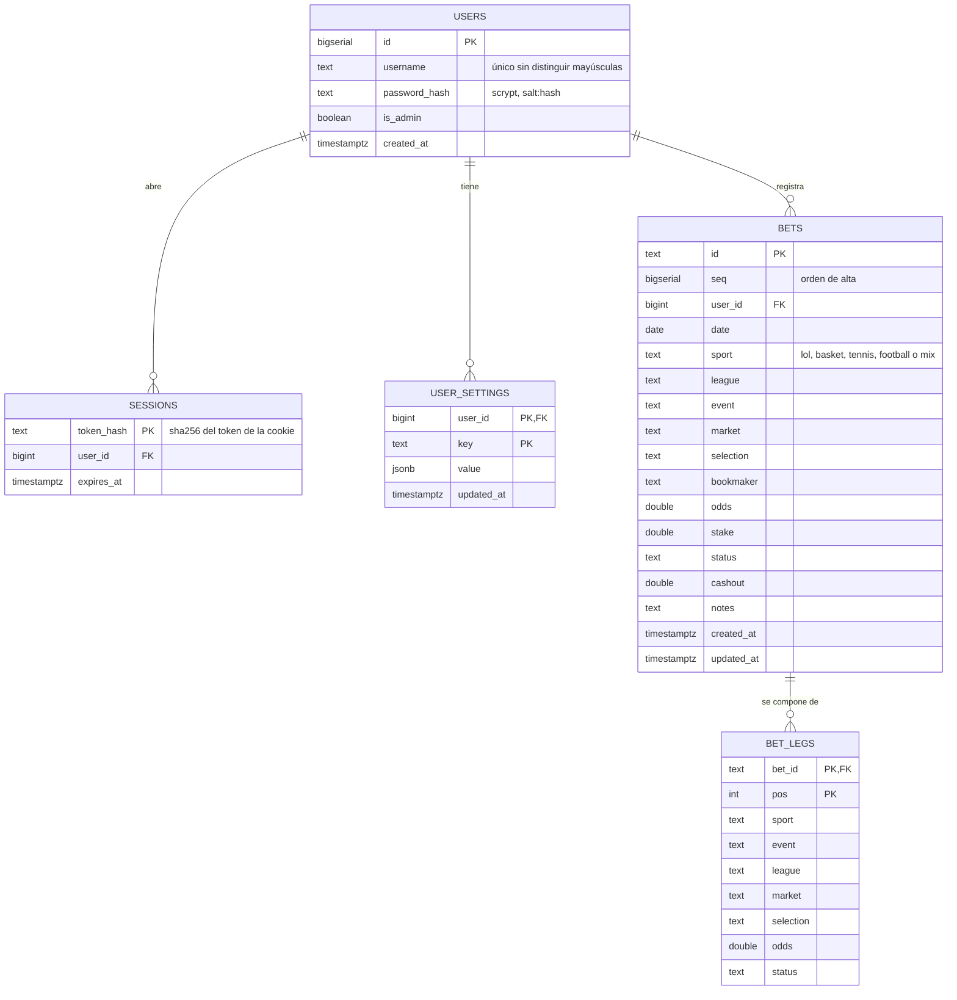
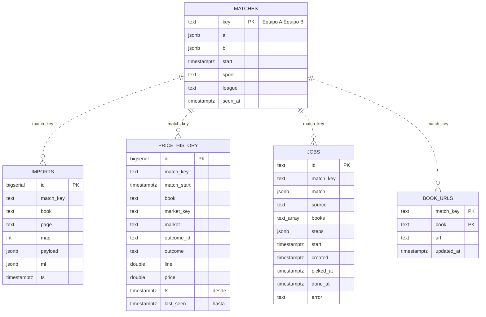

# 10 · Base de datos

Esquema de PostgreSQL 17 (base `lolet`, volumen `pgdata`). Se genera a partir de las migraciones de
`server/services/<servicio>/migrations/`; si hay diferencias, mandan las migraciones. Para más contexto de los
servicios, ver [07-backend.md](07-backend.md).

## Reglas

- **Un esquema por servicio**: `bets`, `esports`, `odds`, `basket`, `tennis`, `football`. Un servicio no toca las tablas de otro; si
  necesita datos de otro, llama a su API.
- No hay claves foráneas entre esquemas. La única relación entre servicios es por valor (`odds.matches.key` es el
  `match_key` de `odds.imports`, `odds.price_history`, `odds.jobs` y `odds.book_urls`, sin restricción).
- Cada esquema tiene su tabla `<esquema>.migraciones` (`nombre`, `fecha`) con los ficheros `.sql` ya aplicados. Una
  migración aplicada no se edita nunca: se crea otra `NNN_*.sql`.
- Todo dato de usuario cuelga de `bets.users` y se filtra siempre por `user_id`.
- El tipo `DATE` se lee como texto `AAAA-MM-DD` y `bigint` como número (ver `server/shared/db.js`).
- Los avisos en vivo no usan tablas: los servicios llaman a `pg_notify('lolet', …)` y el gateway los reenvía por SSE.

## Diagrama

Las líneas punteadas son relaciones lógicas (por valor), no claves foráneas.

## Esquema `bets` (servicio bets)

Usuarios, sesiones, apuestas y ajustes. Migraciones `001` a `006`.

### `bets.users`
| Columna | Tipo | Notas |
|---|---|---|
| `id` | bigserial PK | |
| `username` | text | Índice único `users_name_idx` sobre `lower(username)` |
| `password_hash` | text | `salt:hash` en hexadecimal, scrypt de 64 bytes |
| `is_admin` | boolean | `false` por defecto. El primer usuario registrado es administrador |
| `created_at` | timestamptz | |

### `bets.sessions`
| Columna | Tipo | Notas |
|---|---|---|
| `token_hash` | text PK | SHA-256 del token de la cookie `lolet_session`; el token nunca se guarda |
| `user_id` | bigint FK → `users` | `ON DELETE CASCADE` |
| `expires_at` | timestamptz | 30 días desde el login. Índice `sessions_expires_idx`. Las caducadas se borran en cada login |

### `bets.user_settings`
| Columna | Tipo | Notas |
|---|---|---|
| `user_id` | bigint FK → `users` | `ON DELETE CASCADE` |
| `key` | text | `currency`, `initialBankroll`, `featuredBooks`, `refreshSeconds`, `favoriteLeagues` |
| `value` | jsonb | |
| `updated_at` | timestamptz | |

Clave primaria `(user_id, key)`.

### `bets.settings`
Ajustes comunes a todos (sólo los cambia el administrador). Clave/valor:
`key` text PK, `value` jsonb, `updated_at` timestamptz. Ejemplos: `oddsAutoEnabled`, `oddsRefreshMinutes`,
`oddsAutoHours`, `oddsFarEnabled`, `signupOpen`, `leaguepediaUser`, `leaguepediaPassword`, `lolesportsKey`.

### `bets.bets`
| Columna | Tipo | Notas |
|---|---|---|
| `id` | text PK | UUID que genera el servidor (o el cliente al importar); único entre todos los usuarios |
| `seq` | bigserial | Orden de alta |
| `user_id` | bigint FK → `users` | `ON DELETE CASCADE`. Puede ser `NULL` sólo en apuestas anteriores a las cuentas, que reclama el primer usuario. Índice `bets_user_idx (user_id, seq)` |
| `date` | date | Índice `bets_date_idx` |
| `sport` | text | `CHECK` en `lol`, `basket`, `tennis`, `football`, `mix` (combinada que mezcla deportes; migración 007) |
| `league`, `event`, `market`, `selection`, `bookmaker`, `notes` | text | `NOT NULL DEFAULT ''` |
| `odds`, `stake`, `cashout` | double precision | `NOT NULL DEFAULT 0`. Ver "Puntos a vigilar" |
| `status` | text | `CHECK` en `pending`, `won`, `lost`, `void`, `cashout`, `halfwon`, `halflost` |
| `created_at`, `updated_at` | timestamptz | |

Una combinada es una fila con `market = 'Combinada'` y sus selecciones en `bet_legs`; su cuota y su estado se
recalculan en `normalizeCombo` (`server/services/bets/store.js`).

### `bets.bet_legs`
| Columna | Tipo | Notas |
|---|---|---|
| `bet_id` | text FK → `bets` | `ON DELETE CASCADE` |
| `pos` | int | Posición dentro de la combinada |
| `sport` | text | `CHECK` en `lol`, `basket`, `tennis`, `football` |
| `event`, `league`, `market`, `selection` | text | |
| `odds` | double precision | |
| `status` | text | `CHECK` en `pending`, `won`, `lost`, `void` |
| `ref` | jsonb | Partido y mercado para resolverla sola (migración `008`); igual en `bets.bets` para las simples |

Clave primaria `(bet_id, pos)`.

`ref` (en `bets.bets` y `bets.bet_legs`): `{ sport, match, start, key, out, guessed?, settled? }`. `key` es la clave del
comparador de cuotas (`total|0||212.5`, `player|Asistencias|naji marshall|2.5`) y `out` la selección (`over`, `a`, `x`…).
La valida `cleanRef` en `store.js`; lo que no cuadra se descarta y la apuesta se guarda sin resolución automática.

## Esquema `odds` (servicio odds)

Cuotas leídas de Winamax y Betway, su histórico y la cola de lecturas. Migraciones `001` y `002`.

### `odds.matches`
Partidos abiertos en la app o programados; sirven para saber a qué partido van las cuotas recibidas.
| Columna | Tipo | Notas |
|---|---|---|
| `key` | text PK | `"Equipo A|Equipo B"` con los nombres de la fuente de partidos |
| `a`, `b` | jsonb | Los dos equipos, con su nombre y alias (`alt`) |
| `start` | timestamptz | Hora de inicio |
| `sport` | text | `lol` por defecto |
| `league` | text | |
| `seen_at` | timestamptz | Índice `matches_seen_idx` descendente |

### `odds.imports`
Lo que manda el lector, tal cual. Vale 3 horas y luego se borra.
| Columna | Tipo | Notas |
|---|---|---|
| `id` | bigserial PK | |
| `match_key` | text | Índice `imports_match_idx (match_key, ts DESC)` |
| `book` | text | `CHECK` en `bet365`, `winamax`, `betway` (`bet365` es un resto histórico: ya no se lee) |
| `page` | text | |
| `map` | int | Mapa o periodo; 1 por defecto |
| `payload` | jsonb | Lectura completa de la página |
| `ml` | jsonb | Cuota de ganador `{ a, b }` para las tarjetas del calendario |
| `ts` | timestamptz | |

### `odds.price_history`
Histórico de cuotas. Cada fila es un tramo: la cuota valió `price` desde `ts` hasta `last_seen`.
| Columna | Tipo | Notas |
|---|---|---|
| `id` | bigserial PK | |
| `match_key` | text | |
| `match_start` | timestamptz | Separa las revanchas: dos partidos entre los mismos equipos comparten `match_key` |
| `book` | text | |
| `market_key`, `market` | text | |
| `outcome_id`, `outcome` | text | |
| `line` | double precision | Línea del mercado (puntos, juegos…), si la hay |
| `price` | double precision | |
| `ts` | timestamptz | Inicio del tramo. Índice `price_history_ts_idx` |
| `last_seen` | timestamptz | Última lectura que vio esa cuota. `NOT NULL DEFAULT now()` |

Índice principal `price_history_idx (match_key, book, market_key, outcome_id, ts DESC)`.

### `odds.jobs`
Trabajos de lectura: los del botón "Actualizar cuotas" (`manual`) y los programados (`auto`). El lector los pide con
`GET /jobs/next`.
| Columna | Tipo | Notas |
|---|---|---|
| `id` | text PK | |
| `match_key` | text | Índice `jobs_match_idx (match_key, created DESC)` |
| `match` | jsonb | |
| `source` | text | `CHECK` en `manual`, `auto` |
| `books` | text[] | |
| `steps` | jsonb | |
| `start` | timestamptz | Hora del partido: la cola va por cercanía |
| `created`, `picked_at`, `done_at` | timestamptz | Índice parcial `jobs_open_idx (created) WHERE done_at IS NULL` |
| `error` | text | Motivo si la casa bloqueó o falló la lectura |

### `odds.book_urls`
Dirección de cada partido en cada casa, para ir directo la próxima vez. Clave primaria `(match_key, book)`;
columnas `url` text y `updated_at` timestamptz.

## Esquemas de caché: `esports`, `basket`, `tennis`, `football`

Los cuatro tienen una única tabla con la misma forma (migración `001` de cada uno):

| Tabla | Columnas | Uso |
|---|---|---|
| `esports.cache` | `key` text PK, `value` jsonb, `t` timestamptz | Consultas a Leaguepedia (Fandom limita mucho las peticiones anónimas) |
| `basket.cache` | igual | Respuestas de ESPN y de la API de la Euroliga. Los box scores terminados se guardan mucho tiempo |
| `tennis.cache` | igual | Respuestas de ESPN (tenis), por si no responde |
| `football.cache` | igual | Respuestas de ESPN (fútbol), por si no responde. Un mes de una liga pesa cientos de KB: se guarda como mucho cada 5 minutos |

Cada una tiene un índice `cache_t_idx` sobre `t`. Son datos recuperables: se pueden vaciar sin perder nada del usuario.

## Puntos a vigilar

Detectados al preparar este documento; las tareas relacionadas están en `tareas.md` (local, fuera de git).

- **Dinero en `double precision`**: `stake`, `odds` y `cashout` son coma flotante binaria, lo que puede dar errores de
  redondeo al sumar beneficios. Mejor `numeric(12,2)` para importes y `numeric(8,3)` para cuotas.
- **Restricciones de rango**: la migración `006` añade `CHECK` a `bets.bets` y `bets.bet_legs` (stake y cash out de 0 a
  1.000.000, cuota 0 o de 1 a 1000, longitud de textos) con `NOT VALID`: no se comprueban las filas antiguas, sólo lo nuevo.
  Son los mismos límites que valida `normalizeBet`.
- **`bets.bets.user_id` admite `NULL`** por las apuestas de antes de las cuentas. Cuando ya no quede ninguna se puede
  hacer `NOT NULL`.
- **`bets.bets.id` es global**, no por usuario. Se protege en `writeBet` con `WHERE user_id = EXCLUDED.user_id`, pero la
  base de datos no lo impone; una clave `(user_id, id)` lo haría más robusto.
- **Sin historial de cambios** en las apuestas: `updated_at` guarda cuándo, pero no qué cambió ni quién.
- **Sin claves foráneas dentro de `odds`**: `match_key` no apunta a `odds.matches`, así que pueden quedar filas huérfanas
  en `price_history`, `jobs` y `book_urls`. Hace falta una limpieza periódica (la de `imports` ya existe, a las 3 horas).
- **`odds.price_history` sólo crece**: con lecturas cada pocos minutos de tres deportes, conviene una política de
  retención o particionado por fecha.
- **Un único rol de PostgreSQL** para todos los servicios: la regla de "cada uno su esquema" es una convención, no un
  permiso de la base de datos.
- **Sin tablas todavía para**: movimientos de dinero por casa (depósitos y retiradas), historial de ediciones, registro
  de accesos y recuperación de contraseña. Ver `tareas.md`.
